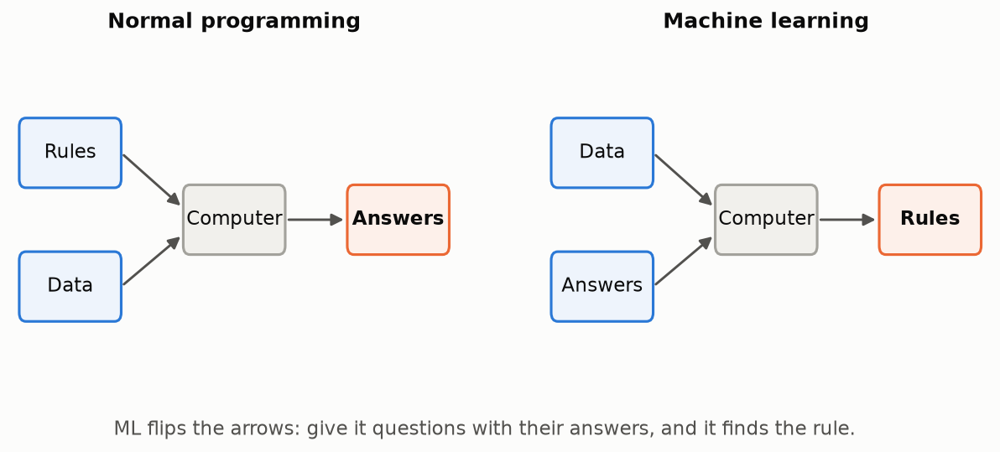
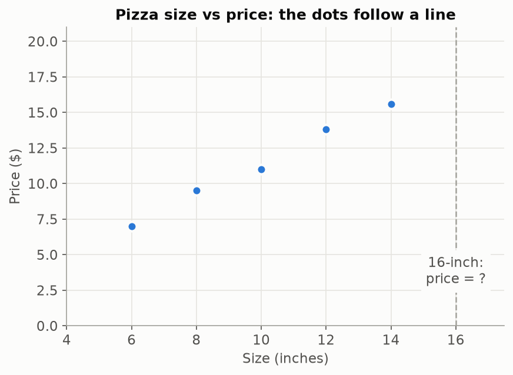
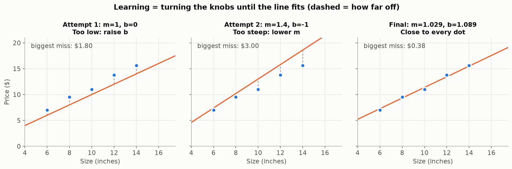

# Lesson 01 — What is Machine Learning?

> Machine learning is when a computer finds a rule from examples, instead of a human writing the rule by hand.

## Prerequisites
- Basic Python (variables, functions, lists).
- Environment set up: see [Setup guide](../../course/SETUP.md).
- No math needed beyond multiplication and addition.

## Why we need it
Some problems have rules that are too complicated for a human to write down. Machine learning (ML) lets the computer **find the rule itself by looking at examples**.

## What if it didn't exist?
Every rule would be written by hand. That is normal programming:

- **Normal programming:** you give the computer **rules + data**, and it gives back **answers**.
- **Machine learning:** you give the computer **data + answers**, and it gives back **the rules**.

ML flips the arrows.



## The problem it solves
Try writing rules for "is this photo a cat?":
- "Has pointy ears"... so do foxes.
- "Has fur"... so do dogs.
- "Has four legs"... so does a table.

You would need thousands of rules, they would still fail, and they would break on every new kind of photo. **Some patterns are easy to see but impossible to write down.** ML handles exactly these.

**Rule of thumb:** if you can write the formula, write it. If you can only show examples, use ML.

| Problem | Use ML? | Why |
|---|---|---|
| Kilometres → miles | No | There's an exact formula (× 0.621). |
| Tax on a bill | No | The rule is known and fixed. |
| Reading handwriting | Yes | Easy to see, impossible to write as rules. |
| Recommending the next song | Yes | Fuzzy, personal patterns hidden in listening history. |

## Analogy
**Teaching a child what a "dog" is.** You never hand a child a rulebook. You point and say "dog… dog… not a dog (that's a cat)… dog." After enough examples, the child builds the rule in their own head, and can even spot a breed they have never seen.

ML is that child. The examples are the **data**, and the rule it builds is the **model**.

**A second analogy: the machine with knobs.** A model is a machine with knobs. Turning the knobs changes what it predicts. **Learning = turning the knobs until the predictions match the real answers.** Every model in this course, up to GPT, is this same idea with more knobs.

## Visuals

**Step 1: look at the data.** Five pizzas with their sizes and prices. The dots clearly follow a straight-ish line, but what does a 16-inch pizza cost?



**Step 2: turn the knobs.** A straight line has two knobs:
- `m`, the **tilt** (how much the price rises for each extra inch)
- `b`, the **shift** (moves the whole line up or down)

The dashed grey lines show how far off each prediction is. Each attempt looks at the misses and nudges a knob in the better direction:



*(Attempts 1 and 2 are example nudges. The final values are from a real learner's session.)*

## Step-by-step explanation

**1. Data = examples with answers.**

| Size (inches) — the question | Price ($) — the answer |
|---|---|
| 6 | 7.00 |
| 8 | 9.50 |
| 10 | 11.00 |
| 12 | 13.80 |
| 14 | 15.60 |

**2. A model = a rule with knobs.** Our rule is a straight line:

```
predicted price = m × size + b
```

- `m` (tilt): the dollars added per extra inch.
- `b` (shift): a starting amount added to every pizza.

**3. Make a prediction by hand.** Take m = 1 and b = 0, with a 10-inch pizza:

```
predicted price = 1 × 10 + 0 = 10.00
real price      = 11.00
miss            = 11.00 − 10.00 = 1.00   (the line is too low by $1)
```

The line is too low, so we **raise b**. Try m = 1, b = 1:

```
predicted price = 1 × 10 + 1 = 11.00   → miss = 0.00 for this pizza
```

But now check the 14-inch pizza: 1 × 14 + 1 = 15.00, while the real price is 15.60. It is still a bit low at the big end, so we **raise m** slightly. That's learning: **look at the misses → nudge a knob → check again.**

**4. Use the model.** With the final knobs m = 1.029 and b = 1.089:

```
16-inch price = 1.029 × 16 + 1.089 = 16.464 + 1.089 = 17.553  → about $17.55
```

The model now answers a question it never saw in the data. That is the whole point.

## Hands-on exercise
Open [`notebook.ipynb`](notebook.ipynb) and fill in every `TODO`:

1. Plot the 5 pizzas as dots (`plt.scatter`).
2. Write `predict(size, m, b)` that returns `m * size + b`.
3. Pick `m` and `b`, plot the dots and your line together, and nudge the knobs until the line runs through the dots. **Log every attempt.**
4. Predict the price of a 16-inch pizza.
5. **Bonus:** print real − predicted for each pizza.

**Hints**
- Start with `m = 1`, `b = 0`.
- `predict(sizes, m, b)` works on the whole NumPy array at once.
- Line too low everywhere? Raise `b`. Too steep (fine on the left, way off on the right)? Lower `m`.

Reference solution: [`solution/notebook.ipynb`](solution/notebook.ipynb).

## Common mistakes
- **Calling `plt.show()` between the dots and the line.** `plt.show()` finishes the chart, so the line lands on a new, empty chart. Draw everything first, then call `plt.show()` once.
- **Typing the numbers again instead of reusing variables.** Writing `predict(16, 1.029, 1.089)` means changing a knob in one cell won't update the others. Use `predict(16, m, b)`.
- **Not logging attempts.** The log *is* the learning process. Later, the computer keeps exactly this record (the "loss history").
- **Chasing precise decimals.** m = 1.029 isn't "more correct" than m = 1.03. Many lines are nearly as good. To compare them fairly, we need a single number that measures "how wrong": that's Lesson 03.

## Quiz
1. **In one sentence, how is ML different from normal programming?**
   <details><summary>Answer</summary>Normal programming takes rules + data and produces answers; ML takes data + answers and produces the rules.</details>
2. **Should you use ML to convert Celsius to Fahrenheit? Why?**
   <details><summary>Answer</summary>No. There is an exact, known formula (F = C × 1.8 + 32). Use ML only when the rule can't be written down.</details>
3. **In `price = m × size + b`, what are the "knobs" and what does each one do to the line?**
   <details><summary>Answer</summary><code>m</code> tilts the line (price added per extra inch); <code>b</code> shifts the whole line up or down.</details>
4. **Your line runs below every dot. Which knob do you turn, and which way?**
   <details><summary>Answer</summary>Raise <code>b</code>. It lifts the whole line without changing its tilt.</details>
5. **What does "learning" mean in ML?**
   <details><summary>Answer</summary>Repeatedly adjusting the model's knobs so its predictions get closer to the real answers.</details>

## How it connects
In this lesson **you** were the learner. You judged "close" by eye and decided which knob to nudge. The next lessons hand each of those jobs to the computer:

| What you did by hand | Lesson that automates it |
|---|---|
| Chose a straight line as the rule | 02 — A model is just a function |
| Judged "how close" by eye | 03 — Loss: one number for "how wrong" |
| Decided which way to nudge | 04 — Derivatives as direction |
| Nudged, re-plotted, repeated | 05 — Gradient descent |
| All of it, automatically | 06 — Build: linear regression from scratch |

**The final model:** the digit recognizer in Lesson 16 has about 100,000 knobs, and GPT-style models have billions. It's still "turn the knobs until the predictions match the answers," just at a scale no human could do by hand.

## Glossary terms introduced
- **Machine learning (ML)**
- **Data / example**
- **Model**
- **Parameter (knob)**
- **Training (learning)**
- **Prediction**

See [course/GLOSSARY.md](../../course/GLOSSARY.md).
