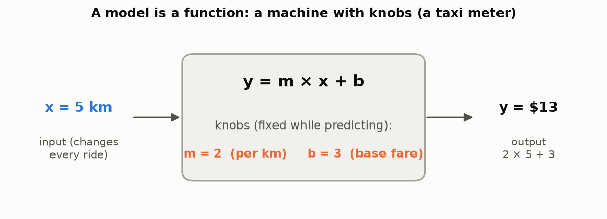
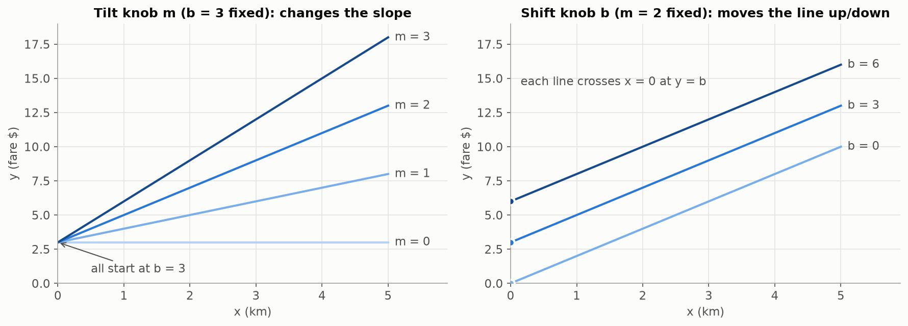
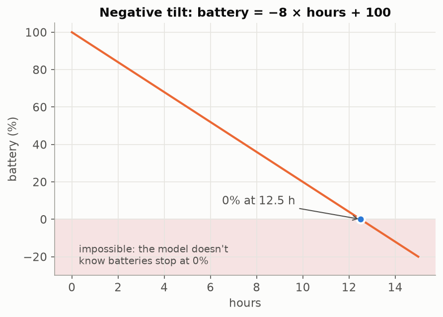
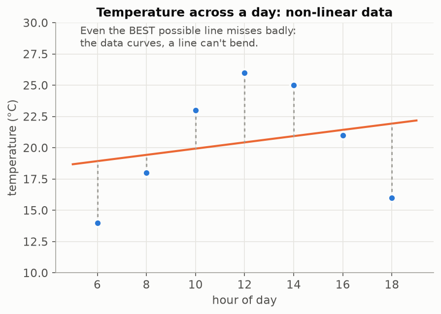

# Lesson 02 — A Model Is Just a Function

> A model is a recipe that turns an input number into an output number, controlled by a few knobs.

## Prerequisites
- [Lesson 01 — What is ML?](../01-what-is-ml/README.md): data, models, and knobs.
- Multiplication and addition.

## Why we need it
In Lesson 01 we found a line that fit the pizza prices. But a line on a chart is just a *picture*, and a computer can't use a picture. It needs the rule written as an exact **recipe**: put a number in, get a number out. That recipe is a **function**, and the function *is* the model.

## What if it didn't exist?
The rule would live only in someone's head or on a chart. To price a 16-inch pizza, you'd have to squint at the graph and guess.

## The problem it solves
- A picture **can't run** on new inputs automatically.
- A picture **can't be adjusted precisely**. "Make it a bit steeper" isn't an instruction a computer can follow.
- A picture **can't be shared**. Two people squinting at the same chart get different answers.

A function fixes all three: the same input always gives the same output, and the knobs are exact numbers.

## Analogy
**A taxi fare meter.** You put in the distance (km), and the meter gives you the fare. Inside, two settings decide the fare: a **per-km rate** and a **base fare**.

There are **two kinds of numbers**:

| | What it is | When it changes |
|---|---|---|
| **Input** (km) | The question | Every ride |
| **Knobs** (rate, base fare) | Part of the machine | Only when the company *re-tunes* the meter |

- **Using a model (predicting):** the knobs stay fixed and the inputs change.
- **Training a model:** we change the knobs.

## Visuals

**The model as a machine:**



**What each knob does.** Tilt (`m`) changes how steep the line is. Shift (`b`) slides the whole line up or down, and it is where the line crosses x = 0:



**A negative tilt makes the line go down.** Note that the model happily predicts −20% battery. A function only knows its formula, nothing about the real world:



**A line can't bend.** Even the best possible line misses curved data badly:



## Step-by-step explanation

**1. In words.** Fare = (rate × km) + base fare.

**2. With numbers.** Set the meter to rate = 2 and base = 3:

| km (input) | Working | Fare (output) |
|---|---|---|
| 0 | 2 × 0 + 3 | **3** ← base fare: paid before moving |
| 1 | 2 × 1 + 3 | **5** |
| 2 | 2 × 2 + 3 | **7** |
| 5 | 2 × 5 + 3 | **13** |

Each extra km adds exactly **2** (the tilt). At 0 km the fare is **3** (where the line starts).

**3. Why does `b` mark where the line crosses x = 0?** At x = 0 the tilt part disappears, because `m × 0 = 0`, leaving `y = b`. In taxi terms: zero km means you pay only the base fare.

**4. Now the symbols.** Only two new ones:
- **x** = the input (km, pizza size, GB of data)
- **y** = the output (fare, price, bill)

```
y = m × x + b
```

This is `fare = rate × km + base`, written shorter. The pizza line from Lesson 01 and the taxi meter are **the same function** with different knob settings.

**5. Worked example: a phone plan.** $10 per month plus $0.50 per GB:
- x = GB used, m = 0.50, b = 10, so y = 0.50 × x + 10
- 4 GB: y = 0.50 × 4 + 10 = 2 + 10 = **$12**
- Next month, with 6 GB, only **x** changes. The plan (the knobs) stays the same.

**6. Negative tilt.** A battery starts at 100% and loses 8% per hour: m = −8, b = 100.
When does it hit 0%? Set y = 0 → 0 = −8 × x + 100 → 8 × x = 100 → x = **12.5 hours**.

**7. The limit of a line.** Temperatures rise in the morning and fall in the evening, so the data curves. Turning `m` and `b` can only choose *which straight line*. No setting makes it bend. Data like this is called **non-linear**.

## Names you'll see elsewhere
Other books and libraries use different names for the same two knobs. They all mean the same thing:

| This course | Maths books | ML / neural networks |
|---|---|---|
| tilt `m` | slope | **weight** `w` |
| shift `b` | intercept | **bias** `b` |

You'll meet "weights and biases" again in neural networks. They're these same knobs.

## Hands-on exercise
Open [`exercise.ipynb`](exercise.ipynb) and fill in every `TODO`:

1. Write `predict(x, m, b)`.
2. Taxi meter (m = 2, b = 3): compute the fares for `[0, 1, 2, 5]` km with **one** call. Expect `[3, 5, 7, 13]`.
3. Plot `m` = 0, 1, 2, 3 (b = 3) on one chart. What does m = 0 mean for a taxi?
4. Plot `b` = 0, 3, 6 (m = 2) on one chart. Where does each line cross x = 0, and why?
5. Model a battery losing 8% per hour from 100%. When does it hit 0%?
6. **Bonus:** try to fit a line to a day's temperatures.

**Hints**
- `np.linspace(0, 5, 50)` gives 50 evenly spaced values from 0 to 5.
- Loop over the knob values, call `plt.plot(..., label=...)` inside, then `plt.legend()` and `plt.show()` once.

**When you're done, compare:**
- Reference solution: [`solution/notebook.ipynb`](solution/notebook.ipynb).
- One learner's build, for comparison: [`notebook.ipynb`](notebook.ipynb).

## Common mistakes
- **Counting points with `linspace`.** `np.linspace(0, 12, 12)` gives 12 points *spread* over 0–12 (0, 1.09, 2.18, …), not whole hours. 0 to 12 inclusive is **13** points: use `np.linspace(0, 12, 13)` or `np.arange(0, 13)`. Think of fence posts: 12 gaps need 13 posts.
- **Trusting the model outside reality.** `predict(15, -8, 100)` gives −20% battery. The function doesn't know about the real world's limits. Always sanity-check predictions.
- **Mixing up input and knobs.** Next month's 6 GB changes `x`, not `m` or `b`. Knobs only change during training.
- **Skipping the "why" questions in comments.** The plot shows *what* happens; writing *why* is what makes it stick.

## Quiz
1. **In `y = m × x + b`, which numbers change when you *use* the model, and which change when you *train* it?**
   <details><summary>Answer</summary>Using: only the input <code>x</code> changes. Training: the knobs <code>m</code> and <code>b</code> change.</details>
2. **With m = 0, what does the line look like, and what does it mean for a taxi?**
   <details><summary>Answer</summary>A flat, horizontal line. The fare is the base fare no matter how far you travel.</details>
3. **Where does the line y = 3 × x + 7 cross x = 0? Why?**
   <details><summary>Answer</summary>At y = 7. At x = 0, 3 × 0 = 0, so y = b = 7.</details>
4. **A gym charges a $20 joining fee plus $15 per month. Write the model, and compute the cost after 6 months.**
   <details><summary>Answer</summary>y = 15 × x + 20. After 6 months: 15 × 6 + 20 = 90 + 20 = <b>$110</b>.</details>
5. **Why can't any setting of `m` and `b` fit temperatures across a day?**
   <details><summary>Answer</summary>The data rises then falls (it curves), but a line can only go one way. The function's shape limits what it can learn.</details>

## How it connects
- **From Lesson 01:** the "rule with knobs" now has an exact form: `y = m × x + b`.
- **To Lesson 03:** we can now compute a prediction for every example. Next we compare each prediction with the real answer and squeeze all the misses into **one number** that says how wrong the line is: the **loss**.
- **To the final model:** a neural network is also just a function, built from many small `m × x + b` pieces (weights and biases) with a twist that lets it **bend**. That's how it fits curved data like the temperatures.

## Glossary terms introduced
- **Function**
- **Input (x)**
- **Output (y)**
- **Slope / weight**
- **Intercept / bias**
- **Linear / non-linear**

See [course/GLOSSARY.md](../../course/GLOSSARY.md).
