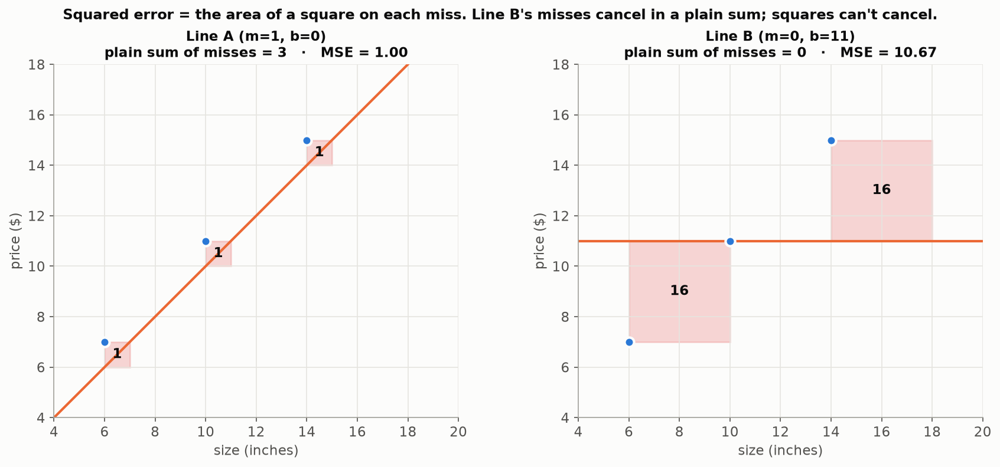
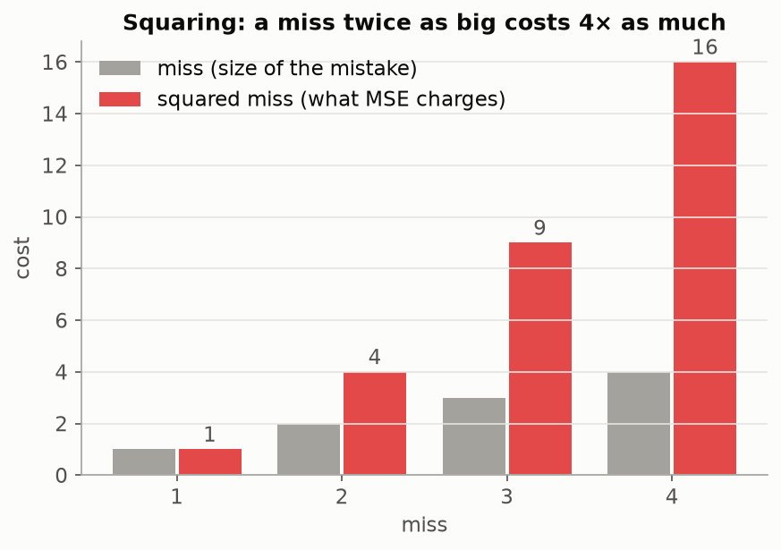
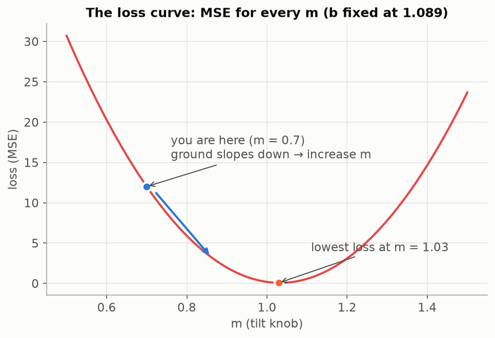

# Lesson 03 — Loss: One Number for "How Wrong"

> Loss turns all of a model's mistakes into a single score: lower is better, 0 is perfect.

## Prerequisites
- [Lesson 01 — What is ML?](../01-what-is-ml/README.md): fitting a line by eye.
- [Lesson 02 — A model is just a function](../02-model-is-a-function/README.md): `y = m × x + b`, input vs knobs.
- Squaring a number (3² = 3 × 3 = 9) and taking an average.

## Why we need it
To learn, a computer must be able to tell whether a new setting of the knobs is **better or worse** than the last one. It can't eyeball a chart. It needs **one number** that measures how wrong the model is: the **loss**.

## What if it didn't exist?
We'd be back to a human squinting at charts. Shown two lines that both look "pretty close," nobody could say which is better, and the computer couldn't even start.

## The problem it solves
Learning is a loop: *nudge a knob → check whether things got better → repeat*. Without a loss there is nothing to check, so there is no direction and no learning.

## Analogy
**A golf score.** Golf turns a whole round (many holes, many mistakes) into **one number**, and **lower is better**. Loss does the same for a model: every miss on every example becomes one score, and training tries to make it as low as possible.

**Why square the misses? A speeding fine that grows fast.** 5 km/h over gets a small fine; 20 km/h over gets a *huge* one. Squaring makes the model care most about fixing its worst mistakes.

## Visuals

**Squared error is literally the area of a square on each miss.** In a plain sum, Line B's −4 and +4 cancel to a "perfect" 0. Squares can't cancel:



**Squaring punishes big misses more:**



**The loss curve.** Fix `b`, try every `m`, and plot the loss. It's a U-shaped valley. The best `m` is at the bottom, and from anywhere else "downhill" points toward it:



## Step-by-step explanation

Three pizzas, two lines to score:

| Size (x) | Real price (y) | Line A (m=1, b=0) predicts | Line B (m=0, b=11) predicts |
|---|---|---|---|
| 6 | 7 | 6 | 11 |
| 10 | 11 | 10 | 11 |
| 14 | 15 | 14 | 11 |

Line A is clearly better (Line B is flat and ignores size). Let's find a score that agrees.

**Attempt 1: add up the misses** (miss = real − predicted):

| | Line A | Line B |
|---|---|---|
| 6" | 7 − 6 = +1 | 7 − 11 = −4 |
| 10" | 11 − 10 = +1 | 11 − 11 = 0 |
| 14" | 15 − 14 = +1 | 15 − 11 = +4 |
| **Sum** | **3** | **0** ← "perfect"?! |

The −4 and +4 **cancel out**. Being too high on one pizza and too low on another doesn't make you right. ❌

**Attempt 2: square each miss, then average.** Squaring makes every miss positive (negative × negative = positive):

| | Line A | Line B |
|---|---|---|
| 6" | (+1)² = 1 | (−4)² = 16 |
| 10" | (+1)² = 1 | 0² = 0 |
| 14" | (+1)² = 1 | (+4)² = 16 |
| Sum | 3 | 32 |
| **Average (÷ 3)** | **1** | **10.67** |

Line A wins. ✅ We take the **average** so the score doesn't grow just because there are more examples.

**Why squaring changes the winner.** Line C misses by 3, 0, 0, 0. Line D misses by 1, 1, 1, 1.
- Plain distances: C = 3, D = 4, so C looks better.
- Squared: C = (9 + 0 + 0 + 0) ÷ 4 = **2.25**. D = (1 + 1 + 1 + 1) ÷ 4 = **1**. **D wins.**

MSE prefers a model that's a little wrong everywhere over one that's perfect mostly but badly wrong somewhere.

**The name and the symbols.** This recipe is called **Mean Squared Error (MSE)**. The name is the recipe read backwards: *error* → *squared* → *mean*.

One new symbol: **ŷ** ("y-hat") = the model's **prediction**. The hat means "a guess". Plain **y** is the real answer.

```
miss = y − ŷ
MSE  = average of (y − ŷ)²
```

**In code**, one line per word of the name:

```python
def mse(y, y_hat):
    err = y - y_hat               # error
    err_squared = err ** 2        # squared
    return np.mean(err_squared)   # mean
```

**The loss curve.** Keep `b` fixed and compute the MSE for 101 values of `m` between 0.5 and 1.5. Plotting loss against `m` gives a **U-shaped valley**. The bottom (here m = 1.03) is the best tilt for that `b`. Standing at m = 0.7, the ground slopes down to the right, so **increase m**. Finding that direction without seeing the whole curve is the next lesson.

## Hands-on exercise
Open [`exercise.ipynb`](exercise.ipynb) and fill in every `TODO`:

1. Write `mse(y, y_hat)`: error → squared → mean, with no loops.
2. Check it: Line A should give **1.0**, Line B **10.67**.
3. Score the Lesson 01 hand-fit line (m = 1.029, b = 1.089) on the 5 pizzas. Can you beat it?
4. ⭐ Fix b = 1.089, compute the MSE for 101 values of `m`, and plot the loss curve. Find the lowest point with `np.argmin`. What shape is it? Standing at m = 0.7, which way would you turn the knob?
5. **Bonus:** draw each squared error as a square on the chart.

**Hints**
- NumPy works on whole arrays: `y - y_hat`, `err ** 2`, `np.mean(...)`.
- `np.argmin(losses)` gives the *position* of the smallest loss; `ms[position]` gives that m.
- For the squares, use `Rectangle((x, min(y, y_hat)), side, side)` with `side = abs(y - y_hat)`, and `ax.set_aspect("equal")`.

**When you're done, compare:**
- Reference solution: [`solution/notebook.ipynb`](solution/notebook.ipynb).
- One learner's build, for comparison: [`notebook.ipynb`](notebook.ipynb).

## Common mistakes
- **Feeding the wrong array in as the input.** `predict(prices, 0.6, 4)` uses *prices* as `x`. The input is the **size**: `predict(sizes, 0.6, 4)`. A tell-tale sign: the "line" isn't straight.
- **Forgetting to call the function.** `mse_loss = (prices, prices_hat)` just makes a pair of arrays. It needs `mse(prices, prices_hat)`.
- **Adding plain misses.** Positive and negative misses cancel, so a terrible line can score 0. Always square (or otherwise make positive) first.
- **Vague directions.** "Walk down the curve" is true but not something a computer can do. "Increase m" is.

## Quiz
1. **Why can't we just add up the misses?**
   <details><summary>Answer</summary>Positive and negative misses cancel out, so a line that's badly wrong in both directions can score 0 (falsely "perfect").</details>
2. **A line misses by +2, −2, +1, −1. What's its MSE?**
   <details><summary>Answer</summary>Squares: 4 + 4 + 1 + 1 = 10. Average: 10 ÷ 4 = <b>2.5</b>.</details>
3. **Line C misses by 3, 0, 0, 0; Line D by 1, 1, 1, 1. Which has the lower MSE, and why?**
   <details><summary>Answer</summary>D (1 vs 2.25). Squaring punishes one big miss more than several small ones.</details>
4. **What does ŷ mean, and how is it different from y?**
   <details><summary>Answer</summary>ŷ ("y-hat") is the model's prediction; y is the real answer.</details>
5. **On the U-shaped loss curve, you're at a point left of the bottom. Should you increase or decrease m?**
   <details><summary>Answer</summary>Increase m: the curve slopes down toward the right, toward the bottom.</details>

## How it connects
- **From Lesson 02:** the function makes predictions ŷ. Loss compares them with the real answers y.
- **To Lesson 04:** the loss curve is a valley. Blindfolded on it, you'd *feel the tilt under your feet* to know which way is downhill. That tilt is the **slope**, also called the **derivative**, and it tells the computer which way to turn each knob.
- **To Lesson 05:** keep stepping downhill until you reach the bottom. That's **gradient descent**, the computer finally turning the knobs by itself.
- **To the final model:** every model in this course, up to GPT, is trained by making a loss number smaller. Only the model and the exact loss change.

## Glossary terms introduced
- **Loss**
- **Error / miss (residual)**
- **Mean Squared Error (MSE)**
- **ŷ (y-hat)**
- **Loss curve**

See [course/GLOSSARY.md](../../course/GLOSSARY.md).
