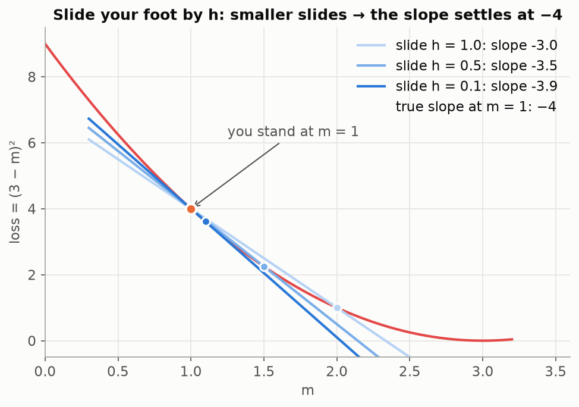
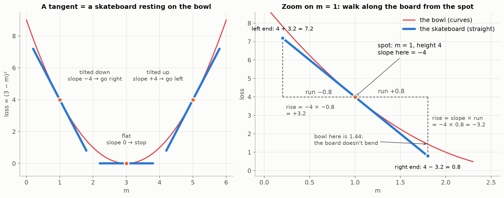
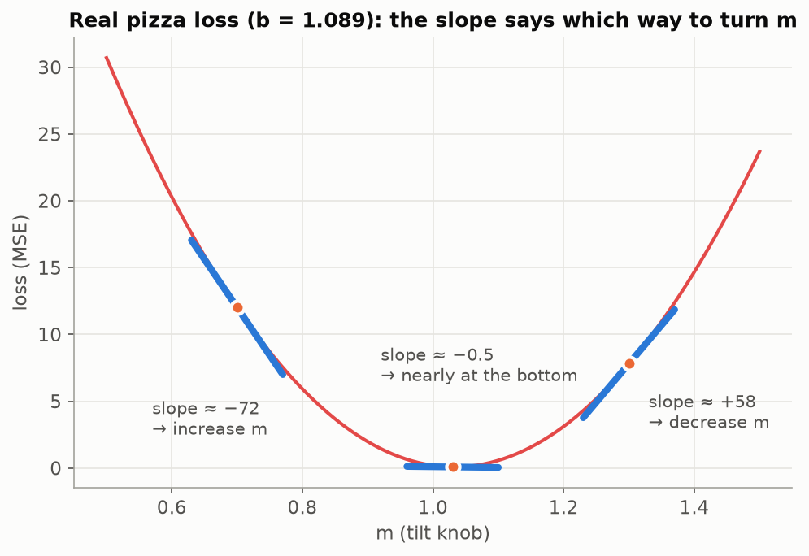

# Lesson 04 — Derivatives as Direction

> The derivative is the slope of the loss right where you stand: its sign says which way to turn a knob, its size says how far you are from the bottom.

## Prerequisites
- [Lesson 02 — A model is just a function](../02-model-is-a-function/README.md): straight lines, `y = m × x + b`.
- [Lesson 03 — Loss](../03-loss/README.md): MSE and the U-shaped loss curve.
- Subtraction and division. No calculus needed.

## Why we need it
The computer is **blindfolded**. It never sees the whole loss curve; it can only compute the loss at the spot where it stands. To improve, it needs to know, **right there**, which way is downhill and how steep it is. The **derivative** tells it exactly that.

## What if it didn't exist?
We'd do what Lesson 03 did: try **every** value of the knob and pick the lowest. That cost 101 tries for one knob. Now count what it costs as knobs are added:

| Knobs | Values to try (101 per knob) |
|---|---|
| 1 (m) | 101 |
| 2 (m, b) | 101 × 101 = 10,201 |
| 3 | 101 × 101 × 101 ≈ 1 million |
| 100,000 (a digit recognizer) | more than there are atoms in the universe |

## The problem it solves
Trying everything **explodes**. Real models have millions of knobs, so we need to improve them **without looking everywhere**: feel the tilt here, take a step, repeat. The derivative is "feel the tilt here," and it costs just **two** loss calculations per knob.

## Analogy
**Blindfolded on a hillside.** You can't see the valley, but you can slide your foot a tiny bit to the right and feel whether the ground went **up** or **down**, and **by how much**. That's the slope:

```
slope = rise ÷ run = (height after a tiny slide − height here) ÷ tiny slide
```

**A skateboard resting on a bowl** (for drawing the slope, see below). Set a rigid, straight board down on the curve at one spot. Its tilt is the slope there: tilted down to the right means it would roll right, and flat means you're at the bottom.

## Visuals

**Sliding your foot by a smaller and smaller `h`:** the measured slope settles on one number, −4. That limit is the derivative.



**The slope as a skateboard (tangent line) at three spots, and how to find the board's ends:**



**On the real pizza loss from Lesson 03**, the slope tells which way to turn `m`, with no need to draw the curve:



## Step-by-step explanation

**1. A tiny loss to play with.** One pizza: size 1, real price 3. The prediction is `m × 1`, so:

```
loss = (3 − m)²     ← the bottom is at m = 3 (loss 0)
```

**2. Slide your foot by 0.1 at three spots:**

| Stand at | Loss here | Loss at +0.1 | Rise ÷ run | Slope | Meaning |
|---|---|---|---|---|---|
| m = 1 | (3−1)² = 4 | (3−1.1)² = 3.61 | (3.61 − 4) ÷ 0.1 | −3.9 | Ground drops to the right → **increase m** |
| m = 5 | (3−5)² = 4 | (3−5.1)² = 4.41 | (4.41 − 4) ÷ 0.1 | +4.1 | Ground rises to the right → **decrease m** |
| m = 3 | (3−3)² = 0 | (3−3.1)² = 0.01 | (0.01 − 0) ÷ 0.1 | ≈ 0.1 | Almost flat → **at the bottom** |

**3. Two rules come out of this table:**
1. **Sign → direction.** Move the knob **opposite** to the slope's sign. Negative → increase. Positive → decrease.
2. **Size → distance.** A steep slope (−4) means **far** from the bottom; a gentle slope (−0.2) means **close**. At m = 1, 2 and 3 the slopes are −3.9, −1.9 and ≈ 0: they shrink as you approach the bottom.

**4. Why "tiny"?** At m = 1, slide by smaller amounts:

| Slide h | Slope |
|---|---|
| 0.1 | −3.9 |
| 0.01 | −3.99 |
| 0.001 | −3.999 |
| 0.0001 | −3.9999 |

The slope closes in on **−4**. The slope for an infinitely tiny slide is the **derivative**.

**5. The symbol (just one).**

```
dL/dm    read: "how much the Loss changes when m changes a tiny bit"
```

It's a **name**, not a fraction to compute. It means "slope of the loss at this spot." Here, dL/dm at m = 1 is −4.

## Drawing the slope: the tangent line (the skateboard) 🛹

Many learners get stuck here. Read this slowly.

**What it's for.** The slope −4 at m = 1 is just a number. A **tangent line** turns it into a picture: a straight line that touches the curve at one spot and has exactly the curve's tilt there.

**The picture.** Set a **skateboard** down on the bowl at one spot. The board is **straight and rigid**. It touches the bowl at that one spot and does **not** bend with it.
- At m = 1 the board tilts down to the right (slope −4): it would roll right.
- At m = 3, the bottom, it's flat (slope 0): it stays put.
- At m = 5 it tilts down to the left (slope +4): it would roll left.

**Finding the board's two ends.** A straight line only needs two points. You know **slope = rise ÷ run**. Flip it: **rise = slope × run**.

Stand on the spot (m = 1, height 4, slope −4):

| Walk | Run | Rise = slope × run | End height | End point |
|---|---|---|---|---|
| 0.8 to the right | +0.8 | −4 × 0.8 = −3.2 (down) | 4 − 3.2 = **0.8** | (1.8, 0.8) |
| 0.8 to the left | −0.8 | −4 × −0.8 = +3.2 (up) | 4 + 3.2 = **7.2** | (0.2, 7.2) |

Join the two ends: that's the tangent.

**The rule in one line:**

```
board height at any m = spot height + spot slope × (m − spot)
                                      └──── slope × run ────┘
```

This is just Lesson 02's straight line: a fixed tilt and a fixed starting point.

**⚠️ The trap.** Every rise is measured **from the spot**, using **the spot's slope**. The board never asks the bowl for its height or slope anywhere else. It's rigid.

At m = 1.8 the board is at **0.8**, but the bowl is at (3 − 1.8)² = **1.44**. They're different because the bowl curves up and away from the board. They're equal only at the spot, which is why a tangent "touches" the curve.

If your "tangent" bends and follows the curve, you've computed the height and slope at **each point** instead of **once at the spot**. It's like a taxi meter that re-tunes its rate every km.

**All three boards, for checking:**

| Spot | Spot height | Spot slope | Left end | Right end |
|---|---|---|---|---|
| m = 1 | 4 | −4 | (0.2, 7.2) | (1.8, 0.8) |
| m = 3 | 0 | 0 | (2.2, 0) | (3.8, 0) |
| m = 5 | 4 | +4 | (4.2, 0.8) | (5.8, 7.2) |

## The real pizza loss
On the 5 pizzas from Lesson 03 (b fixed at 1.089), sliding by h = 0.0001:

| m | Slope | Turn m |
|---|---|---|
| 0.7 | ≈ −72 | increase |
| 1.03 | ≈ −0.53 | increase, a little: the true bottom is at m ≈ 1.0325 |
| 1.3 | ≈ +58 | decrease |

The signs match the Lesson 03 valley (negative on the left, positive on the right), and the computer never drew the curve.

**"Tiny" depends on the curve.** With h = 0.01, the slope at m = 1.03 comes out **+0.54**, the wrong sign! The pizza valley has much steeper walls than `(3 − m)²` (slopes around ±70 instead of ±4), so a 0.01 slide already climbs partway up the far wall. **If shrinking `h` changes the answer, `h` wasn't tiny enough.**

**Every knob has its own slope.** Holding m = 1.03 and sliding only `b` gives a slope of about +0.02, so decrease `b`. Each knob gets its own "how does the loss change if I nudge only this one?"

## Hands-on exercise
Open [`exercise.ipynb`](exercise.ipynb) and fill in every `TODO`:

1. Write `tiny_loss(m)` = `(3 − m)²`.
2. Write `slope(f, m, h)`: slide by `h` and return rise ÷ run. Check it against the table: −3.9, +4.1, 0.1 with h = 0.1.
3. Shrink `h` at m = 1 and see what the slope approaches.
4. Draw the bowl and three tangent lines (skateboards) at m = 1, 3, 5.
5. ⭐ Write `pizza_loss(m)` using **all 5 pizzas**, then compute its slope at m = 0.7, 1.03, 1.3 and decide which way to turn m.
6. **Bonus:** fix m = 1.03 and compute the slope for the other knob, `b`.

**Hints**
- A Python function can take another function as an argument: inside `slope`, call `f(m)`.
- For the tangents, follow the skateboard section above: compute the spot's height and slope **once**, then two ends with `spot height + spot slope × (m − spot)`.
- Reuse `mse` and `predict` from Lesson 03 for the pizza loss.

**When you're done, compare:**
- Reference solution: [`solution/notebook.ipynb`](solution/notebook.ipynb).
- One learner's build, for comparison: [`notebook.ipynb`](notebook.ipynb).

## Common mistakes
- **The tangent bends with the curve.** The height and slope were computed at every point instead of once at the spot. The board is rigid: use the **spot's** height and slope, and the distance `m − spot`.
- **Getting the tangent's range wrong.** "spot − 0.8 to spot + 0.8" for spot 1 is **0.2 to 1.8**, not −1.8 to 1.8.
- **Scoring only one example.** A loss like `(m × 6 + b − 7)²` scores only the 6-inch pizza. The loss must cover **all** examples (average the squared misses over all of them). A clue: the slope at the known bottom wasn't near 0.
- **`h` too big.** On steep curves, h = 0.01 can even give the wrong sign. Shrink `h` until the answer stops changing.
- **Typing numbers again** (like `/ 5` or `1.089`) instead of reusing variables and functions. It silently breaks when the data changes.

## Quiz
1. **At some spot the slope of the loss is −2.5. Should you increase or decrease the knob?**
   <details><summary>Answer</summary>Increase it. A negative slope means the loss goes down to the right.</details>
2. **One spot has slope −4 and another −0.2. Which is closer to the bottom?**
   <details><summary>Answer</summary>The −0.2 spot. The slope shrinks to 0 as you reach the bottom, so a gentle slope means you're close.</details>
3. **Using loss = (3 − m)²: at m = 2 the loss is 1, and at m = 2.1 it's 0.81. What's the slope?**
   <details><summary>Answer</summary>(0.81 − 1) ÷ 0.1 = <b>−1.9</b>, so increase m.</details>
4. **A tangent touches the curve at m = 5, where the height is 4 and the slope is +4. Where is its right end at m = 5.8?**
   <details><summary>Answer</summary>rise = 4 × 0.8 = 3.2, so the height is 4 + 3.2 = <b>7.2</b>: the point (5.8, 7.2).</details>
5. **Why not just try every value of every knob?**
   <details><summary>Answer</summary>The number of tries explodes: 101 per knob means 101^k for k knobs. The slope tells you the direction using just two loss calculations per knob.</details>

## How it connects
- **From Lesson 03:** the loss curve is a valley; the slope tells you which way is downhill *without seeing the valley*.
- **To Lesson 05:** repeat "measure slope → step the other way" over and over until the slope is ~0. That's **gradient descent**, the computer turning the knobs by itself. The shrinking slope near the bottom naturally makes the steps smaller.
- **To the final model:** a neural network has a slope for **every** knob. The list of all those slopes is called the **gradient**. Computing it efficiently for millions of knobs is **backpropagation** (Lesson 14).

## Glossary terms introduced
- **Slope**
- **Derivative (dL/dm)**
- **Tangent line**
- **Slide size h**

See [course/GLOSSARY.md](../../course/GLOSSARY.md).
